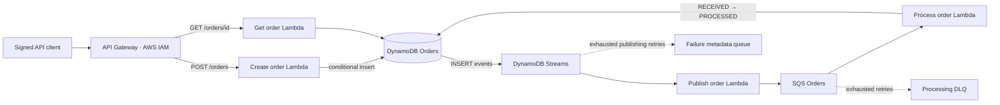

# AWS Serverless Orders

[](https://github.com/helberjf/aws-serverless-orders/actions/workflows/ci.yml)

An event-driven order-processing API built with **TypeScript, AWS Lambda, API Gateway, DynamoDB Streams, SQS, and AWS SAM**. It demonstrates asynchronous processing, conditional database writes, partial batch retries, dead-letter queues, least-privilege IAM policies, and infrastructure as code.

The application accepts an order, persists it as `RECEIVED`, and processes it asynchronously into `PROCESSED`. A second endpoint lets callers check the result. Processing here means an atomic status transition; payment, inventory reservation, and shipping integrations are outside this project's current scope.

## Architecture



The API performs one durable write. The stream publisher sends the committed order ID to SQS, avoiding the original gap where DynamoDB succeeded but SQS failed inside the same HTTP request. Stream publishing and SQS delivery are **at least once**: the consumer uses a conditional update and verifies completed duplicates with a consistent read. It does not promise exactly-once external side effects.

## Implemented behavior

- Strict JSON and field validation, including base64 API Gateway request bodies.
- `POST /orders` persists an order and returns `201` with its ID and initial status.
- `GET /orders/{orderId}` returns the current order, `404` if absent, or `400` for an invalid ID.
- Stream filtering plus an application guard prevent status updates from publishing new work.
- Failed SQS messages are retried individually; successful messages in the same batch are acknowledged.
- A 30-second consumer timeout, 180-second queue visibility timeout, five receives before the DLQ, and 14-day failure-queue retention.
- IAM-authorized API, per-function resource permissions, encrypted SQS queues, DynamoDB point-in-time recovery, JSON logs, tracing, and CloudWatch alarms.
- Unit tests, coverage thresholds, formatting, linting, type checking, SAM validation/build, and GitHub Actions CI.

## Run checks locally

Requirements: Node.js **24.x**, npm, and the [AWS SAM CLI](https://docs.aws.amazon.com/serverless-application-model/latest/developerguide/install-sam-cli.html). AWS credentials are not needed for the mocked unit tests or local build. Docker is needed only for `sam local` or a container-based build.

```bash
npm ci
npm run check
npm run validate
npm run build
```

Dependencies and commands live at the repository root. Tests cover validation boundaries, persistence failures, stream checkpoints, duplicate processing, missing orders, poison messages, and partial batch failures. AWS service calls are mocked; passing these checks does not prove a live AWS deployment.

## API contract

Both routes require an IAM principal with `execute-api:Invoke` on the deployed API. Sign HTTP requests with AWS Signature Version 4 for the `execute-api` service in your deployment region. The `ApiInvokeArn` stack output provides the resource ARN for that caller policy.

### Create an order

`POST /orders`, `Content-Type: application/json`

```json
{
  "customerId": "customer-123",
  "productId": "product-ABC",
  "quantity": 2
}
```

Customer and product IDs must be non-empty strings of at most 128 characters after trimming. Quantity must be a JSON integer between 1 and 1000. The service generates the order ID and status; caller-supplied extra fields are ignored.

Example `201` response:

```json
{
  "orderId": "d73b82b5-bcf4-4aae-a3b3-0e726019f8e0",
  "customerId": "customer-123",
  "productId": "product-ABC",
  "quantity": 2,
  "status": "RECEIVED",
  "createdAt": "2026-11-04T10:00:00.000Z"
}
```

### Read an order

`GET /orders/d73b82b5-bcf4-4aae-a3b3-0e726019f8e0`

The `200` response contains the same order fields. After successful processing, `status` becomes `PROCESSED` and `processedAt` is added. The consumer preserves this timestamp on duplicate deliveries. Error responses have a JSON `message` field; AWS internal error details are not returned.

## Deploy and demonstrate

Configure your AWS account/role, then build and review the deployment change set:

```bash
aws sts get-caller-identity
npm run build
sam deploy --guided
```

The checked-in defaults use stack name `aws-serverless-orders` and region `sa-east-1`. Deployment creates billable AWS resources; select the account and region deliberately. The table is retained on deletion. See the [upgrade and cleanup notes](docs/operations.md) if an earlier version is already deployed.

To exercise the actual deployed pipeline, install Boto3 and run the signed smoke test with a role permitted to describe the stack and invoke its API:

```bash
python -m pip install boto3
python scripts/smoke-test.py --stack-name aws-serverless-orders --region sa-east-1
```

The smoke test creates one demo order, polls its status for up to 90 seconds, and exits unsuccessfully if processing does not finish. It uses the normal AWS credential chain, including `AWS_PROFILE` and temporary session credentials. It leaves the demo order in DynamoDB. Only run this command against the intended deployed stack; it is not part of CI and has not been run merely by installing the project.

The `events/` directory includes API, DynamoDB stream, and SQS examples for `sam local invoke`. Local Lambda emulation does **not** automatically emulate DynamoDB/SQS or connect the event sources. Provide environment overrides with actual resource names and use the unit tests for an entirely offline check.

## Reliability boundaries

- HTTP request retries are not deduplicated: each valid `POST` creates a new order. Add a client idempotency key before using the API for purchases.
- Idempotency currently protects the database status transition. External payment or fulfillment services need their own idempotency and reconciliation strategy.
- DynamoDB Streams retain events for 24 hours. Publishing retries are bounded; failures and expired streams require reconciliation from persisted `RECEIVED` orders. The publisher failure queue contains metadata, not replayable order payloads.
- IAM controls API access for trusted callers. Customer-level authorization and tenant isolation are not implemented.
- CloudWatch alarms have no notification actions until an operator configures them. There is no automatic deployment or claim of a production rollout.

The [operations guide](docs/operations.md) covers monitoring, DLQ redrive, publishing recovery, migration, and cleanup.

## Repository layout

```text
src/create-order/    HTTP validation and conditional persistence
src/get-order/       Strongly consistent status lookup
src/publish-order/   DynamoDB Streams → SQS
src/process-order/   Idempotent SQS consumer
src/shared/         AWS clients, validation and response helpers
tests/              Unit tests with mocked AWS clients
events/             Sample invocation payloads
scripts/            Signed live-deployment smoke test
docs/operations.md  Recovery and deployment notes
template.yaml       AWS SAM infrastructure
.github/workflows/  Continuous integration (no AWS credentials)
```

## Design references

- [AWS Lambda with SQS: visibility timeout and retries](https://docs.aws.amazon.com/lambda/latest/dg/services-sqs-configure.html)
- [Partial batch responses for DynamoDB Streams](https://docs.aws.amazon.com/lambda/latest/dg/services-ddb-batchfailurereporting.html)
- [DynamoDB stream failure destinations and retention limits](https://docs.aws.amazon.com/lambda/latest/dg/services-dynamodb-errors.html)
