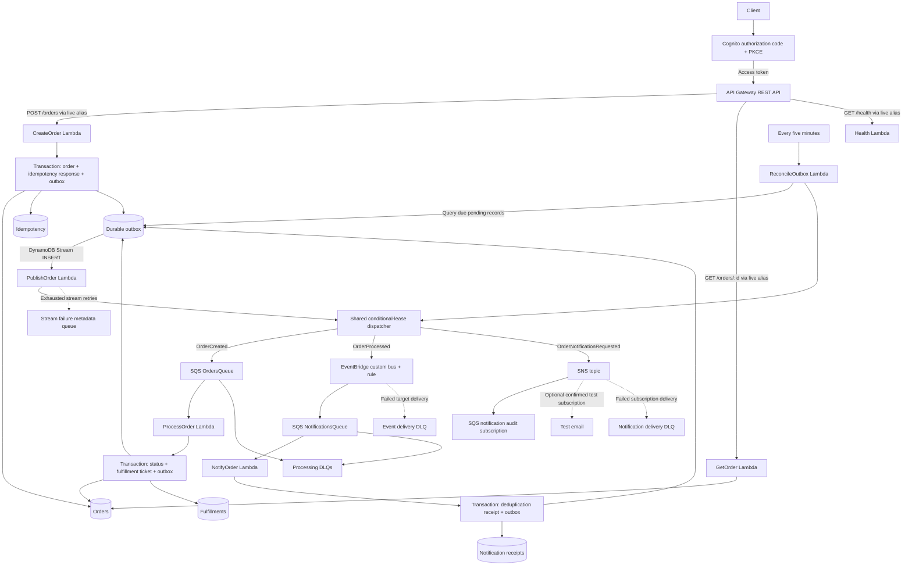

# AWS Serverless Order Processing — Event-Driven Architecture with TypeScript

A serverless backend that accepts authenticated orders, creates durable fulfillment tickets, and distributes business notifications. It demonstrates transactional consistency, at-least-once delivery, idempotency, least-privilege function roles, and controlled releases using AWS SAM.

**Verification status:** 133 local tests pass, including real DynamoDB Local transactions. SAM validates and builds all seven functions. Live AWS deployment, managed retries/DLQs, Cognito sign-in, and canary rollback have **not** been demonstrated in this environment. GitHub Actions execution is subject to the account billing restriction recorded in [validation evidence](docs/validation.md).

## Project overview

`POST /orders` commits the order and its publication intent together. A background consumer atomically changes `RECEIVED` to `PROCESSED`, creates a fulfillment ticket, and records an `OrderProcessed` event. EventBridge routes that event to a notification consumer, which creates another durable publication intent for SNS.

`PROCESSED` means **ready for fulfillment**. This project does not charge a card, reserve external inventory, or claim that an order was shipped. There are no artificial processing delays.

## Architecture diagram



CloudWatch Logs, embedded metrics, alarms, a dashboard, and X-Ray cover the functions and API. CodeDeploy shifts traffic between immutable versions behind the three HTTP `live` aliases. The outbox is the recovery authority; a stream failure record is diagnostic metadata.

## Technology stack

| Layer          | Choice                                                                 |
| -------------- | ---------------------------------------------------------------------- |
| Runtime        | Node.js 24, TypeScript strict, AWS SDK v3                              |
| Validation     | Zod                                                                    |
| Infrastructure | AWS SAM and CloudFormation; esbuild bundles                            |
| Tests          | Vitest + V8 coverage; DynamoDB Local; offline SAM transformation tests |
| Operations     | AWS Lambda Powertools for TypeScript, CloudWatch, X-Ray                |
| Quality        | ESLint, Prettier, Black for Python operator tools, dependency auditing |
| Delivery       | GitHub Actions, OIDC, reviewed CloudFormation Change Sets, CodeDeploy  |

One root npm package and lockfile serve all handlers. Separate workspaces would add maintenance overhead without a separate release or dependency boundary.

## Key engineering decisions

- **Transactional outbox:** business writes and publication intents commit in the same DynamoDB transaction. External delivery is retryable and may duplicate.
- **Conditional business effects:** one fulfillment ticket per order; concurrent and duplicate deliveries cannot repeat the committed transition.
- **Recovery independent of stream retention:** pending outbox records do not expire. A bounded GSI query recovers due work after stream retries or retention are exhausted.
- **Cognito ownership:** identity comes from the verified token subject, never from the request's `customerId`.
- **No unnecessary orchestration:** Step Functions is deliberately excluded because the current business operation is one transaction. A payment/reservation saga would introduce a different boundary.

See [architecture decisions](docs/architecture-decisions.md), including migration, storage, duplicate notification, and cost trade-offs.

## AWS services

| Service               | Purpose                                                                            |
| --------------------- | ---------------------------------------------------------------------------------- |
| API Gateway + Cognito | REST endpoints, OAuth scopes, JWT signature verification and throttling            |
| Lambda                | Seven small HTTP, processing, publication, recovery, and notification handlers     |
| DynamoDB + Streams    | Orders, idempotency responses, fulfillment tickets, outbox, deduplication receipts |
| SQS Standard          | Work buffering, managed retry, partial batch failures, and dead-letter queues      |
| EventBridge           | Route the `OrderProcessed` business event to notification processing               |
| SNS                   | Fan out notifications to an audit queue and optional test email                    |
| CloudWatch + X-Ray    | Structured logs, metrics, alarms, dashboard and sampled traces                     |
| CodeDeploy            | HTTP alias traffic shifting and alarm-driven rollback configuration                |
| IAM, KMS, S3          | Scoped roles, encryption, and versioned deployment artifacts                       |

## REST API endpoints

| Method | Path                | Authorization                                           | Success                                |
| ------ | ------------------- | ------------------------------------------------------- | -------------------------------------- |
| POST   | `/orders`           | Cognito access token with `orders/write`                | `201` with original order snapshot     |
| GET    | `/orders/{orderId}` | Cognito access token with `orders/read`, matching owner | `200` with current order               |
| GET    | `/health`           | Public                                                  | `200` basic liveness; no database call |

Inputs require trimmed `customerId` and `productId` strings of 1–128 characters, an integer `quantity` from 1–1000, and UUID v4 order IDs. JSON bodies are bounded to 16 KiB. Unknown input fields are discarded by the schema.

After [Cognito login](docs/deployment.md#authenticate-and-run-live-tests), use the deployed `ApiBaseUrl` and a short-lived access token. Do not commit tokens or paste them into logs.

```bash
curl "$API_BASE/health"

curl --request POST "$API_BASE/orders" \
  --header "Authorization: Bearer $ACCESS_TOKEN" \
  --header 'Content-Type: application/json' \
  --header 'Idempotency-Key: demo-order-001' \
  --data '{"customerId":"customer-123","productId":"product-ABC","quantity":2}'

curl "$API_BASE/orders/d73b82b5-bcf4-4aae-a3b3-0e726019f8e0" \
  --header "Authorization: Bearer $ACCESS_TOKEN"
```

Illustrative `201` response:

```json
{
  "orderId": "d73b82b5-bcf4-4aae-a3b3-0e726019f8e0",
  "customerId": "customer-123",
  "productId": "product-ABC",
  "quantity": 2,
  "status": "RECEIVED",
  "createdAt": "2026-11-04T12:00:00.000Z",
  "updatedAt": "2026-11-04T12:00:00.000Z"
}
```

After processing, GET also returns `processedAt` and `fulfillmentId`, with `status: "PROCESSED"` and the new `updatedAt`. The internal `ownerId` is excluded. Responses include `X-Request-Id`; creation also returns `Idempotency-Key` and `Idempotency-Replayed`.

Errors have `{ "code", "message", "requestId" }`. Expected statuses are `400` invalid input, `401/403` authentication or scope failure, `404` missing or inaccessible order, `409` reuse of an unexpired idempotency key with a different payload, and generic `500` for internal failures. Gateway throttling may return `429`. Stack traces, AWS exception details, and credentials never enter HTTP error responses.

## Event flow

1. CreateOrder commits an order, its original idempotent response, and `OrderCreated:<orderId>`.
2. The outbox stream invokes PublishOrder. A conditional lease protects dispatch; the scheduled reconciler uses the same logic.
3. `OrderCreated` becomes an SQS processing message. The event source mapping polls in batches.
4. ProcessOrder commits the final status, a `READY_FOR_FULFILLMENT` ticket, and `OrderProcessed:<orderId>` together.
5. The dispatcher calls EventBridge with source `com.helberjf.orders`, detail type `OrderProcessed`, and versioned detail.
6. The rule sends the event envelope to NotificationsQueue. NotifyOrder commits a deduplication receipt and `OrderNotificationRequested:<orderId>`.
7. The dispatcher publishes to SNS. The raw SQS audit subscription makes fan-out observable without any real email recipient.

See [event examples](events/README.md). EventBridge's transport event ID and the stable business `detail.eventId` serve different purposes.

## Idempotency and reliability

Supply the same `Idempotency-Key` on every retry of a creation request. Keys are scoped to the owner, hashed before storage, and valid for 24 hours. Same key plus normalized payload returns the original `201` response, even if the order is already processed. Different payload returns `409`. After expiry, the key may create a new order. For compatibility, omitting the key generates and returns one; a retry that never received that key cannot safely deduplicate.

The processing transaction uses the prior status and `updatedAt` as conditions. Ambiguous write failures are reconciled with a strongly consistent read. The single transaction makes a separate `PROCESSING` lease/state unnecessary.

SQS, EventBridge, and SNS delivery are **at least once**. If a publish succeeds but recording its acknowledgment fails, the outbox can publish again. Conditional consumer transactions prevent duplicate business effects, but a standard SNS subscriber can still receive the same notification more than once. Subscribers must deduplicate the stable event ID when that matters. No exactly-once transport or email guarantee is claimed.

## SQS retry and DLQ strategy

Both consumers use batch size 10, a one-second batching window, 30-second function timeout, and 181-second visibility timeout (`6 × 30 + 1`). `ReportBatchItemFailures` returns only failed message IDs. Five unsuccessful receives lead to a processing DLQ; source retention is four days and DLQ retention is fourteen days.

Outbox stream processing has bounded retries and sends exhausted failure metadata to PublishFailuresQueue. Pending intents survive independently. The reconciler runs every five minutes, queries at most two pages of twenty due items, and applies a 120-second lease and bounded exponential backoff. It performs no table scan. See [recovery runbooks](docs/operations.md) before replaying anything.

## Security and IAM

API Gateway verifies Cognito JWT signatures. Handlers additionally check access-token type, issuer, client ID, expiry, required scope, and ownership. The public client uses authorization code + PKCE, has no client secret, and uses 15-minute access tokens. User self-registration is disabled; the development helper creates test users without invitations.

Each Lambda has its own role, scoped data/service access, and access only to its log group. X-Ray write actions require wildcard resources and are explicitly documented. Queue/topic policies restrict service senders and deny non-TLS requests. DynamoDB, SQS, SNS, and artifact storage use encryption at rest. A customer-managed KMS key is created only when optional alarm email is enabled.

There are no third-party secrets in this application, so Secrets Manager/SSM would add no useful boundary today. Environment values are resource identifiers. Future provider credentials must be retrieved from Secrets Manager or SSM SecureString with a dedicated scoped permission; they must not become SAM parameters or committed environment files. No browser frontend is included, so CORS is not enabled. [Security review and IAM exceptions](docs/security.md) explains the remaining deployment-role privileges.

## Observability

Powertools emits JSON logs with relevant order, request, message, event, status, and duration fields. AWS SDK clients are instrumented for X-Ray. Payloads and tokens are not logged. Asynchronous boundaries are correlated primarily by `orderId` and business event IDs; a single uninterrupted X-Ray trace across all outbox deliveries is not promised.

The stack defines 26 alarms for Lambda errors/throttles, queue depth/age, DLQs, stream iterator age, application failures, and API 5xx rate. A dashboard groups the key signals. Log retention is fourteen days. Detailed per-method API metrics are disabled to control cost; stage metrics support the API alarm. Email alerts are optional and require explicit recipient configuration and SNS confirmation.

## Canary deployment

CreateOrder, GetOrder, and Health use `AutoPublishAlias: live` and `Canary10Percent10Minutes`. SAM generates versions and CodeDeploy deployment groups. Transformed-template tests confirm API integrations target aliases and deployment groups include automatic rollback configuration.

The first deployment establishes the initial version; a subsequent code/configuration change demonstrates traffic splitting. Under low traffic, 10% routing is probabilistic and may produce little evidence. The API 5xx alarm covers handled HTTP failures that would not increment Lambda's `Errors` metric. Follow the [canary and rollback demonstration](docs/deployment.md#verify-canary-and-rollback); live rollback remains unverified until that procedure is completed.

## CI/CD pipeline

Pull requests run clean installation, type checking, lint, formatting, unit coverage, dependency audit, a credential-pattern check, DynamoDB Local integration tests, infrastructure/tooling tests, SAM validation and build, and a check of the built handlers. Coverage is uploaded as an artifact. Third-party actions are pinned to commit SHAs.

Deployment is manual (`workflow_dispatch`) and reuses CI. OIDC plan and apply roles are distinct. The plan job uploads versioned artifacts and creates a Change Set; the apply job executes the exact reviewed ARN/revision. Production requires `main`, explicit GitHub environment branch rules, reviewers, and disabled administrator bypass. The workflow fails closed when those protections are absent. There are no permanent AWS keys in GitHub Secrets.

## Local development

Prerequisites: Node.js 24, Python 3.12, Git, and Docker. Activate a Python virtual environment before installing the pinned tooling:

```bash
python -m venv .venv
# Linux/macOS: source .venv/bin/activate
# PowerShell: .\.venv\Scripts\Activate.ps1
python -m pip install -r requirements-dev.txt
npm ci
npm run check
docker compose up -d
python scripts/wait-dynamodb.py
npm run test:integration
npm run test:infra
npm run test:tooling
sam validate --lint --region sa-east-1
npm run build
node scripts/check-build.cjs
```

DynamoDB Local binds only to `127.0.0.1:18000`. Integration tests create isolated tables and delete only those tables on the guarded loopback endpoint. They do not access AWS. When the local lab is no longer needed, `docker compose down` stops this repository's disposable local service. Do not use production credentials for local tests.

## Testing

| Level                      | What it verifies                                                                                                     | What it does not prove                                                                       |
| -------------------------- | -------------------------------------------------------------------------------------------------------------------- | -------------------------------------------------------------------------------------------- |
| Unit: 101 tests            | Validation, authorization, races, retries, ambiguous outcomes, partial batches, event publication and telemetry      | AWS service integration                                                                      |
| Local integration: 6 tests | Real DynamoDB transactions through HTTP/worker handlers; concurrency, rollback, ownership and replay                 | Managed Streams, SQS polling, EventBridge, SNS or Cognito; those transports are test doubles |
| Infrastructure: 11 tests   | Expanded SAM aliases, canary/rollback configuration, scopes, queue settings, role boundaries, OIDC workflow controls | Actual AWS IAM authorization or runtime rollout                                              |
| Tooling: 15 tests          | Change-set identity, parameter preservation, plan/apply separation and production protection checks                  | Real GitHub approval or CloudFormation execution                                             |
| Live E2E: operator-run     | API, Cognito, SQS/Streams, fulfillment, EventBridge/SNS, optional DLQ                                                | Not executed here; requires approved development deployment                                  |

Measured coverage: **100% lines, 99.21% statements, 100% functions, 93.75% branches**. Thresholds are 90% lines/statements/functions and 85% branches. All critical handlers have 100% measured line coverage. Coverage is a regression signal, not proof of distributed-system correctness. [Evidence and outstanding checks](docs/validation.md) records the actual scope.

## AWS deployment

Review [estimated costs](docs/costs.md) first. Use [deployment instructions](docs/deployment.md) to provision the OIDC bootstrap from CloudFormation, configure the GitHub environments, review the application Change Set, and deploy development. Production deployment and recurring-cost resources require owner authorization.

Do not automatically merge or deploy this branch. Existing installations must review the [Cognito and outbox migration notes](docs/deployment.md#migrating-an-existing-stack).

## Estimated cost and cleanup

For a small São Paulo lab, budget approximately **US$10–15/month per continuously deployed environment**, before taxes, without assuming credits or free allowances. This is a planning range, not a cap: alarms, metrics, dashboard, polling, logs, retained data, traffic and retries affect it. Optional alarm encryption adds a customer-managed KMS key charge. Two environments increase the budget accordingly. See [assumptions and current price references](docs/costs.md).

No NAT Gateway, ECS, RDS, ALB, or provisioned concurrency is created. Cleanup requires authorization: `sam delete` removes stack resources and queue/log data, while retained DynamoDB tables, the user pool, OIDC provider and artifact bucket need a separate reviewed cleanup decision. See the [cleanup runbook](docs/operations.md#cleanup).

## Trade-offs and future improvements

The recovery index has a single `PENDING` partition suitable for a portfolio workload; shard it before large-scale use. The reconciler's bounded throughput favors predictable cost over rapid bulk recovery. Notification receipts are permanent to protect late replay and need an eventual retention policy tied to business requirements. All three outbox event types share publishing permissions. An external payment provider would require its own idempotency contract and likely an orchestration saga.

Additional production work depends on requirements: load/SLO testing, custom domain/WAF, mandatory MFA, backup restoration drills, security review in the target account, larger recovery capacity, and privacy/deletion workflows. The project does not claim these are already implemented.

Repository presentation text and a DVA-C02 competency map are in [portfolio notes](docs/portfolio.md).
