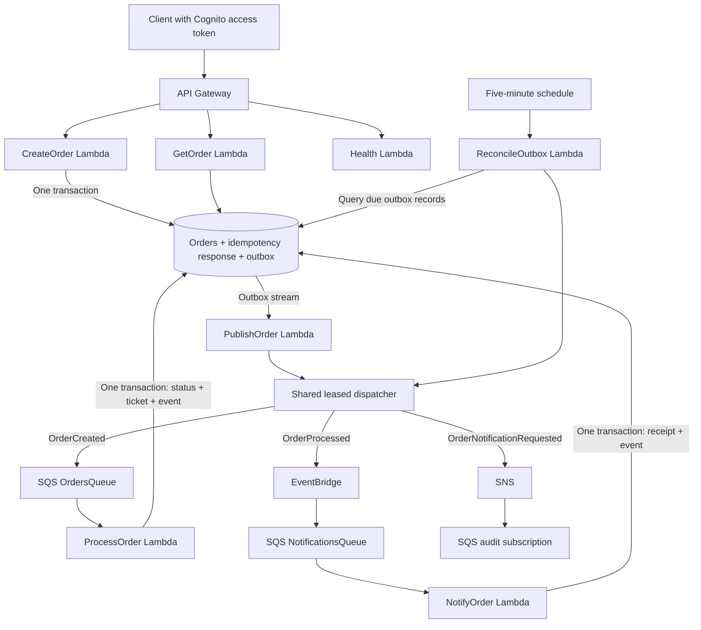

# AWS Serverless Orders

**An event-driven TypeScript backend that turns authenticated order requests into durable fulfillment tickets and business notifications.** The central engineering problem is keeping a database change and its downstream events consistent when requests are retried, messages arrive twice, or a publisher fails halfway through.

The implementation uses AWS Lambda, API Gateway, Cognito, DynamoDB, Streams, SQS, EventBridge and SNS, with AWS SAM for infrastructure. `PROCESSED` means **ready for fulfillment**; payment, inventory reservation and shipping are outside the current business operation.

**Start here:** [Architecture](#architecture) · [Trade-offs](#engineering-decisions-and-trade-offs) · [Run locally](#run-locally) · [API example](#api-example) · [Validation evidence](docs/validation.md) · [Next improvements](#next-improvements)

## At a glance

| Area           | What this repository demonstrates                                                            |
| -------------- | -------------------------------------------------------------------------------------------- |
| Consistency    | DynamoDB transactions commit business state and an outbox event together.                    |
| Retry handling | Owner-scoped HTTP idempotency, conditional consumer transactions and partial batch failures. |
| Recovery       | Stream-triggered publication plus scheduled recovery of pending outbox records.              |
| Security       | Cognito scopes and ownership checks; a separate IAM role per function.                       |
| Operations     | Structured logs, metrics, alarms, X-Ray instrumentation, DLQs and recovery runbooks.         |
| Delivery       | GitHub OIDC, reviewed CloudFormation Change Sets and HTTP canary configuration.              |

**Local validation:** the [2026-11-04 validation record](docs/validation.md) reports **137 passing local tests**, seven built function bundles and a successful containerized health invocation. The record documents the results and execution scope; the [next improvements](#next-improvements) describe the project roadmap.

## Architecture



The diagram groups five separate DynamoDB tables for readability: Orders, Idempotency, Fulfillments, Outbox and NotificationReceipts. Processing and delivery failures have dedicated queues; the complete resources and policies are in [template.yaml](template.yaml).

1. **Accept:** `POST /orders` stores the order, its original idempotent response and `OrderCreated` in one transaction.
2. **Publish:** a stream-triggered publisher dispatches the outbox event to SQS. A scheduled reconciler recovers due work independently of stream retention.
3. **Process:** a conditional transaction changes `RECEIVED` to `PROCESSED`, creates one fulfillment ticket and records `OrderProcessed`.
4. **Notify:** EventBridge routes the event to a second consumer. That consumer stores a deduplication receipt and notification intent together; the dispatcher publishes to SNS.

An SQS audit subscription demonstrates notification fan-out without a real email recipient. An optional test-email subscription requires confirmation. See [event payload examples](events/README.md).

## Engineering decisions and trade-offs

These decisions are recorded in the repository's [architecture decision records](docs/architecture-decisions.md).

| Decision                                                                            | Benefit                                                                               | Cost or boundary                                                                                                                                                  |
| ----------------------------------------------------------------------------------- | ------------------------------------------------------------------------------------- | ----------------------------------------------------------------------------------------------------------------------------------------------------------------- |
| **Transactional outbox instead of a database write followed directly by a publish** | A committed business change always has a durable publication intent.                  | More records, transactions and recovery logic. Publishing and recording its acknowledgment are still separate operations, so duplicate delivery remains possible. |
| **Conditional business transactions with at-least-once delivery**                   | Duplicate messages cannot repeat the committed fulfillment transition.                | Every consumer needs a deliberate idempotency boundary. Standard SNS subscribers can still receive duplicate notifications.                                       |
| **DynamoDB with separate tables and on-demand capacity**                            | Explicit access patterns, retention and IAM boundaries suit an intermittent workload. | Transactions and the recovery index add request cost. The single `PENDING` index partition is a low-volume choice that would need sharding at larger scale.       |
| **Stream trigger plus a bounded scheduled reconciler**                              | Pending work survives beyond stream retries and retention.                            | Recovery queries add cost; a maximum of 40 candidates per scheduled run favors predictable work over rapid bulk recovery.                                         |
| **One atomic fulfillment operation, without Step Functions**                        | Avoids adding orchestration around a single transaction.                              | A future payment/reservation/compensation workflow would need a new domain boundary and may justify a saga.                                                       |
| **Cognito access tokens and owner isolation**                                       | User identity comes from a verified token subject rather than request input.          | Existing IAM clients and legacy rows require an explicit migration. User lifecycle and access policy remain operational responsibilities.                         |
| **Canary releases for HTTP handlers; immediate worker updates**                     | HTTP traffic can shift gradually with alarm-driven rollback configuration.            | Worker changes must remain message/schema compatible. Actual rollback requires a second deployment and observed traffic to verify.                                |

Additional decisions cover notification-receipt retention, low-cardinality metrics, a shared dependency root and separated OIDC plan/apply roles.

## Code review guide

| Start with                                                                                  | What to look for                                                                             |
| ------------------------------------------------------------------------------------------- | -------------------------------------------------------------------------------------------- |
| [CreateOrder](src/create-order/app.ts) and [idempotency helpers](src/shared/idempotency.ts) | Atomic creation, original-response replay, payload conflicts and ambiguous write outcomes.   |
| [Outbox dispatcher](src/shared/outbox.ts) and [reconciler](src/reconcile-outbox/app.ts)     | Conditional leases, retry deadlines, exponential backoff and recovery without a table scan.  |
| [ProcessOrder](src/process-order/app.ts)                                                    | The conditional status transition, unique fulfillment ticket and transaction reconciliation. |
| [NotifyOrder](src/notify-order/app.ts)                                                      | Business-event validation and the receipt/outbox transaction.                                |
| [Integration tests](tests/integration/core.test.ts)                                         | Real DynamoDB Local transactions, concurrent creation/processing, ownership and rollback.    |
| [SAM template](template.yaml) and [infrastructure tests](tests/infra)                       | Authorizers, scopes, queues, roles, generated aliases and deployment controls.               |

## Run locally

Prerequisites: **Node.js 24, Python 3.12, Git and Docker**. The pinned Python requirements include the infrastructure tooling. Activate a virtual environment before installing them.

```bash
git clone https://github.com/helberjf/aws-serverless-orders.git
cd aws-serverless-orders
python -m venv .venv
# Linux/macOS: source .venv/bin/activate
# PowerShell: .\.venv\Scripts\Activate.ps1
python -m pip install -r requirements-dev.txt
npm ci
npm run check

docker compose up -d
python scripts/wait-dynamodb.py
npm run test:integration
npm run test:infra
npm run test:tooling

sam validate --lint --region sa-east-1
npm run build
node scripts/check-build.cjs
```

DynamoDB Local binds to `127.0.0.1:18000`. The integration suite creates isolated tables and deletes only those tables on its guarded loopback endpoint; it does not access AWS. Stop the disposable local service with `docker compose down` when finished. The integration tests exercise handlers directly; this is not a local emulation of the full managed event flow.

**Toolchain:** TypeScript strict, AWS SDK v3, Zod, esbuild, Vitest/V8 coverage, ESLint, Prettier and AWS Lambda Powertools. All seven handlers share one root npm package and lockfile, with separate built bundles.

## API example

| Method | Route               | Authorization                                       | Success                                   |
| ------ | ------------------- | --------------------------------------------------- | ----------------------------------------- |
| `POST` | `/orders`           | Cognito access token, `orders/write`                | `201` and the original order snapshot     |
| `GET`  | `/orders/{orderId}` | Cognito access token, `orders/read`, matching owner | `200` and the current order               |
| `GET`  | `/health`           | Public                                              | `200` liveness response; no database call |

After [development deployment and Cognito login](docs/deployment.md#authenticate-and-run-live-tests), set `API_BASE` to the deployed `ApiBaseUrl` and `ACCESS_TOKEN` to a short-lived access token:

```bash
curl "$API_BASE/health"

curl --request POST "$API_BASE/orders" \
  --header "Authorization: Bearer $ACCESS_TOKEN" \
  --header 'Content-Type: application/json' \
  --header 'Idempotency-Key: demo-order-001' \
  --data '{"customerId":"customer-123","productId":"product-ABC","quantity":2}'

# Use the orderId returned by POST:
curl "$API_BASE/orders/$ORDER_ID" \
  --header "Authorization: Bearer $ACCESS_TOKEN"
```

The initial order has `status: "RECEIVED"`. After processing, GET returns `status: "PROCESSED"`, `processedAt` and `fulfillmentId`. Internal ownership data is excluded from the response. `customerId` is business input; it does not grant ownership.

Requests require non-empty `customerId`/`productId` strings of up to 128 characters and integer `quantity` from 1–1000. Bodies are limited to 16 KiB. Responses include `X-Request-Id`; creation also returns `Idempotency-Key` and `Idempotency-Replayed`. Application errors use `{ "code", "message", "requestId" }`, including `400` invalid input, `404` missing/inaccessible order and `409` conflicting idempotency-key reuse. Authentication, scope and throttling failures are also enforced at the API boundary.

## Reliability boundaries

- **HTTP retries:** provide the same `Idempotency-Key` and normalized payload to replay the original `201` for 24 hours. Keys are owner-scoped and hashed before storage. A different payload with an unexpired key returns `409`. Omitting the key generates one, but a retry that never received it cannot safely deduplicate.
- **Consumer retries:** SQS batches return only failed message IDs. Both consumers use a 30-second timeout, a one-second batching window and 181-second visibility timeout. Five unsuccessful receives send a message to a processing DLQ.
- **Outbox recovery:** pending records do not expire. Published records expire after seven days. Conditional 120-second leases and bounded exponential backoff coordinate the stream publisher and scheduled reconciler.
- **Delivery semantics:** SQS, EventBridge and SNS are at least once. A successful publish followed by a failed acknowledgment write can publish again. Conditional transactions protect business effects; subscribers must deduplicate stable event IDs when physical notification duplicates matter.
- **Notification receipts:** permanent receipts protect late replay and add storage overhead. Business-driven retention policies are part of the [next improvements](#next-improvements).

Use the [operations runbook](docs/operations.md) for alarms, stuck orders, outbox recovery and DLQ redrive. A stream failure record is diagnostic metadata; the durable outbox remains the recovery authority.

## Testing and evidence

The latest [recorded results](docs/validation.md) summarize the automated local checks:

| Layer             | Recorded result   | Scope                                                                                                      |
| ----------------- | ----------------- | ---------------------------------------------------------------------------------------------------------- |
| Unit              | 101 passing tests | Validation, authorization, races, retries, partial batches, publication and telemetry; AWS calls mocked.   |
| Local integration | 7 passing tests   | Real DynamoDB Local transactions and concurrent handlers; SQS/EventBridge/SNS transports use test doubles. |
| Infrastructure    | 13 passing tests  | Expanded SAM resources, aliases, rollback configuration, scopes, queue settings and role boundaries.       |
| Tooling           | 16 passing tests  | Change-set identity, parameter preservation, environment checks and plan/apply separation.                 |

The [development verification guide](docs/deployment.md#authenticate-and-run-live-tests) includes operator-run scripts for the API, Cognito, asynchronous processing, notifications and DLQ exercises. Automating these procedures is part of the project roadmap.

Recorded V8 coverage is **100% lines, 99.21% statements, 100% functions and 93.75% branches**. Coverage is a regression signal, not proof of distributed-system correctness. Test counts and coverage refer to the dated evidence record, not a promise about every later revision.

## Deployment, security and operations

The [deployment guide](docs/deployment.md) covers OIDC bootstrap, GitHub environments, reviewed Change Sets, development deployment, live tests and migration. Plan and apply roles are separate. HTTP handlers use immutable versions behind `live` aliases with `Canary10Percent10Minutes`; production deployment checks require the documented branch and reviewer protections.

[Security notes](docs/security.md) describe Cognito trust, ownership, encryption, least-privilege roles and IAM exceptions. There are no third-party secrets or browser frontend in the current application, so Secrets Manager/SSM and CORS are not enabled without a concrete need.

CloudWatch logs, metrics, 26 configured alarms and a dashboard support operations. Powertools instruments AWS SDK calls for X-Ray; business IDs correlate asynchronous work, without claiming one continuous trace across durable retries. Review [cost assumptions](docs/costs.md) before deploying and the [cleanup runbook](docs/operations.md#cleanup) before deleting resources: retained tables, the user pool and deployment artifacts need separate handling.

## Next improvements

The next iterations focus on the following product and operational improvements, in priority order:

1. **Automate end-to-end testing in AWS.** Integrate the existing verification scripts into the development delivery workflow and publish correlated evidence of order processing, notifications, and canary/rollback behavior.
2. **Benchmark performance and costs.** Add controlled load tests to measure API latency, processing throughput, and cost per order, using the results to guide concurrency and batch-size tuning.
3. **Publish interactive API documentation.** Maintain an OpenAPI specification with Swagger UI and a request collection to simplify authenticated API exploration and demonstrations.
4. **Expand order queries.** Add authenticated order listing per user, pagination, and status filters while preserving ownership isolation.
5. **Extend the business workflow.** Add inventory reservation and payment-provider integration, evaluating Step Functions when coordinated steps and compensating actions justify orchestration.
6. **Improve data recovery and retention.** Exercise backup restoration and define business-driven retention policies that preserve idempotency and protection against late event replay.

Further reading: [architecture decisions](docs/architecture-decisions.md) · [deployment](docs/deployment.md) · [operations](docs/operations.md) · [security](docs/security.md) · [costs](docs/costs.md) · [validation](docs/validation.md) · [portfolio notes](docs/portfolio.md).
